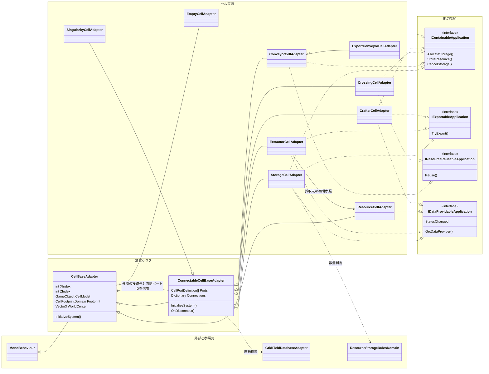
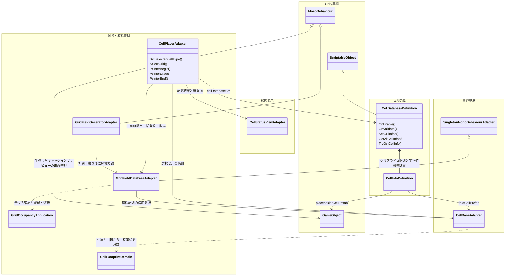

# セルと配置のクラス関係

タグ: `現行設計` `クラス図` `セル` `配置` `Unity配線`

対象版・凡例は [現行設計索引](current-architecture.md)。ここでは管理対象状態と借用参照を区別する。GameObjectの寿命はUnity、配置時の生成・破棄はCellPlacerが制御する。

設備の能力は[有効能力の契約](../spec/effective-stats.md)に従う。`GridFieldDatabaseAdapter.StatEffects` が共有効果を所有し、`SaveCell` が `CellBaseAdapter.ConfigureProgression` へ渡す。抽出・コンベア・保管・加工セルは `EffectiveStatsRulesDomain` の計算値を読み、ProgressionTypeで種類・能力別の倍率と加算値を読み、取得後の共有通知で表示を更新する。交差セルは受領した固定数量を中継する。

## セル型と能力契約

囲みは設計図を読むための分類で、C#の名前空間を表すものではない。配色のfoundationは共通基底、middleは具体セル、surfaceは能力契約、externalは自プロジェクト外の依存を示す。数量規則はfoundation、座標検索を提供するグリッドDBはsurfaceである。「外部と参照先」の囲みはexternalの色分類と同じ区分ではない。

<!-- diagram-id: architecture-cells-grid-1 -->

[Cellsコード](../../Assets/Scripts/Cells/Adapter/) と [CrafterCell](../../Assets/Scripts/Crafting/Adapter/CrafterCellAdapter.cs) が根拠。ResourceCellは固定資源種別と表示定義、Storageは在庫・予約量、Extractorは採取量・非同期処理、Conveyorは一件の搬送資源ID、Crossingは方向別保留搬送、Crafterは入出庫と加工を担う。ResourceCellは接続型ではなく、隣接に保持されても相互接続通知しない。接続変更はOnGetConnectedCell/OnLostConnectedCell、切断はOnDisconnectedで通知する。Extractorは初期化後に前方座標の有効な資源セルを再評価し、対象喪失・交換・設備無効化で未完了進捗を破棄する。稼働と再開の契約は [抽出セルの寿命](../spec/extractor-lifecycle.md) を参照する。

## グリッド管理と定義

<!-- diagram-id: architecture-cells-grid-2 -->

[CellDatabaseDefinition](../../Assets/Scripts/Grid/Definitions/CellDatabaseDefinition.cs) は設定配列を正本としOnEnableで辞書を必ず作る。SetCellInfos/OnValidateで無効化し、取得時に必要なら再構築する。旧保存フラグは実行時状態に使わない。[GridFieldGenerator](../../Assets/Scripts/Grid/Adapter/GridFieldGeneratorAdapter.cs) の生成関数はUNITY_EDITOR限定、Startは [GridDB](../../Assets/Scripts/Grid/Adapter/GridFieldDatabaseAdapter.cs) に既存子階層を登録する。GridDBは座標を持つがセルを自動生成・破棄しない。[Placer](../../Assets/Scripts/Grid/Adapter/CellPlacerAdapter.cs) は非アクティブな雛形を複製し、座標登録・有効化・InitializeSystemが成功してから旧セルを切断・退役させる。課金・復元・範囲順序は[設備設置仕様](../spec/currency-placement.md)を参照する。
