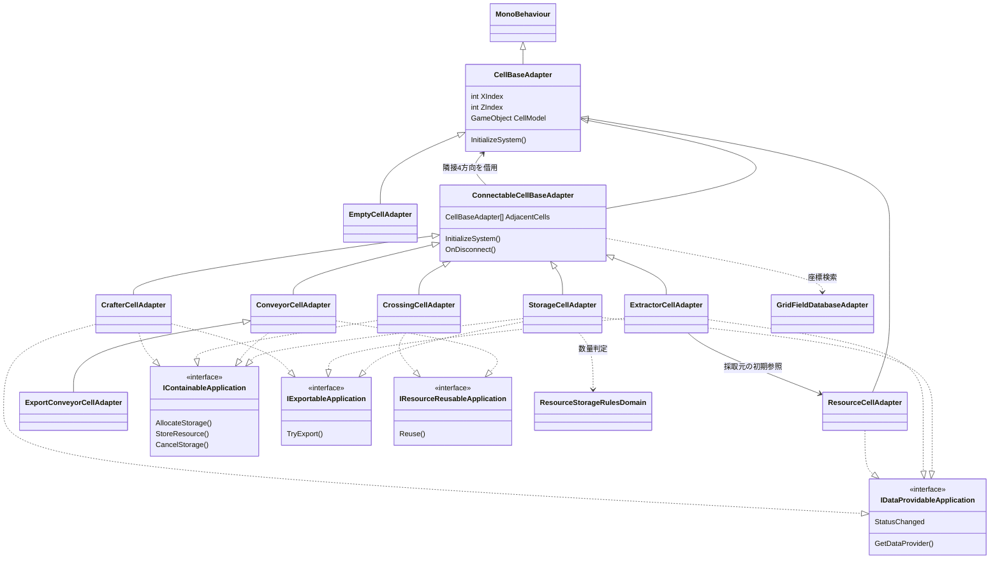
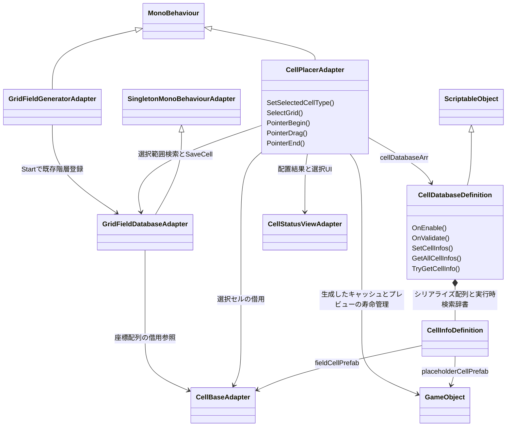

# セルと配置のクラス関係

タグ: `現行設計` `クラス図` `セル` `配置` `Unity配線`

対象版・凡例は [現行設計索引](current-architecture.md)。ここでは管理対象状態と借用参照を区別する。GameObjectの寿命はUnity、配置時の生成・破棄はCellPlacerが制御する。

## セル型と能力契約

<!-- diagram-id: architecture-cells-grid-1 -->

[Cellsコード](../../Assets/Scripts/Cells/Adapter/) と [CrafterCell](../../Assets/Scripts/Crafting/Adapter/CrafterCellAdapter.cs) が根拠。ResourceCellは固定資源種別と表示定義、Storageは在庫・予約量、Extractorは採取量・非同期処理、Conveyorは一件の搬送資源ID、Crossingは方向別保留搬送、Crafterは入出庫と加工を担う。ResourceCellは接続型ではなく、隣接に保持されても相互接続通知しない。接続変更はOnGetConnectedCell/OnLostConnectedCell、切断はOnDisconnectedで通知する。Extractorの資源元選択は初期化時で、再接続・無効化の挙動改善案は現行図に含めない。

## グリッド管理と定義

<!-- diagram-id: architecture-cells-grid-2 -->

[CellDatabaseDefinition](../../Assets/Scripts/Grid/Definitions/CellDatabaseDefinition.cs) は設定配列を正本としOnEnableで辞書を必ず作る。SetCellInfos/OnValidateで無効化し、取得時に必要なら再構築する。旧保存フラグは実行時状態に使わない。[GridFieldGenerator](../../Assets/Scripts/Grid/Adapter/GridFieldGeneratorAdapter.cs) の生成関数はUNITY_EDITOR限定、Startは [GridDB](../../Assets/Scripts/Grid/Adapter/GridFieldDatabaseAdapter.cs) に既存子階層を登録する。GridDBは座標を持つがセルを自動生成・破棄しない。[Placer](../../Assets/Scripts/Grid/Adapter/CellPlacerAdapter.cs) は選択した定義の非アクティブなセル複製をキャッシュし、配置時に再複製、旧セル切断、座標登録、有効化、InitializeSystemを行う。
