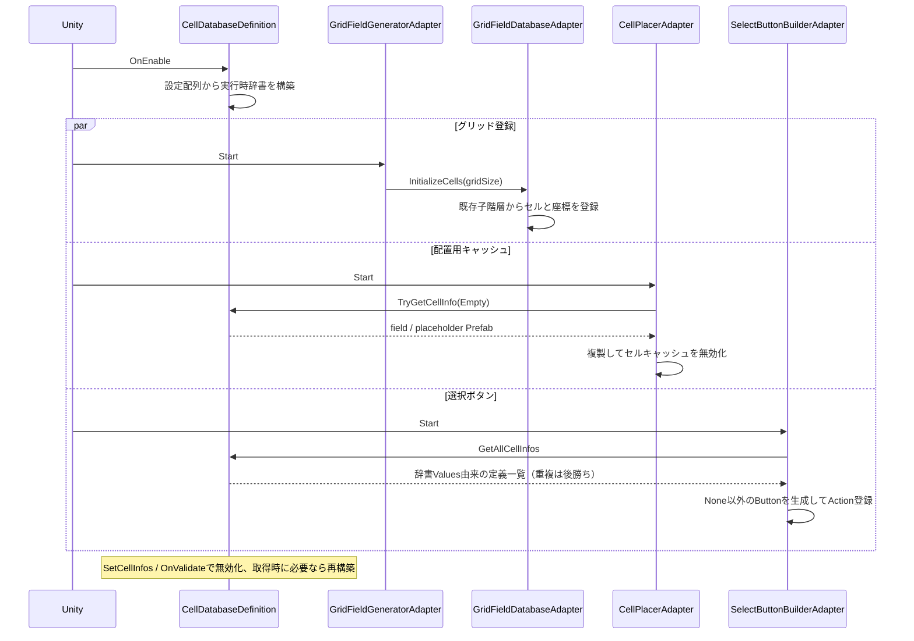
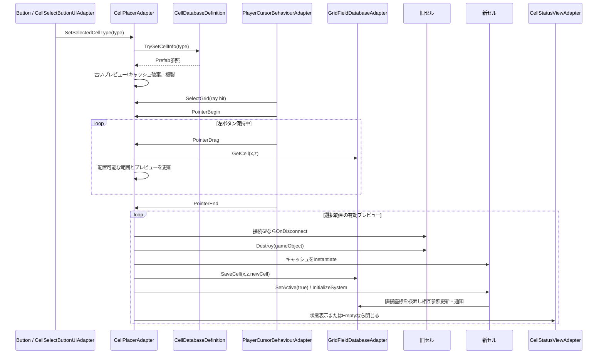
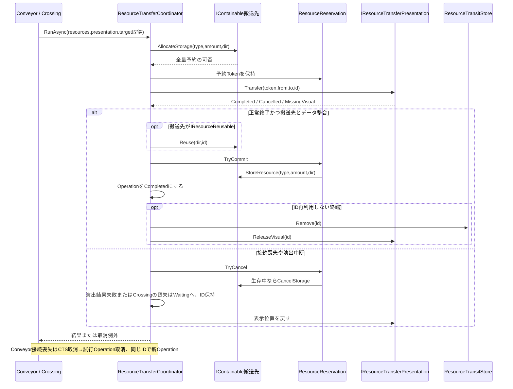
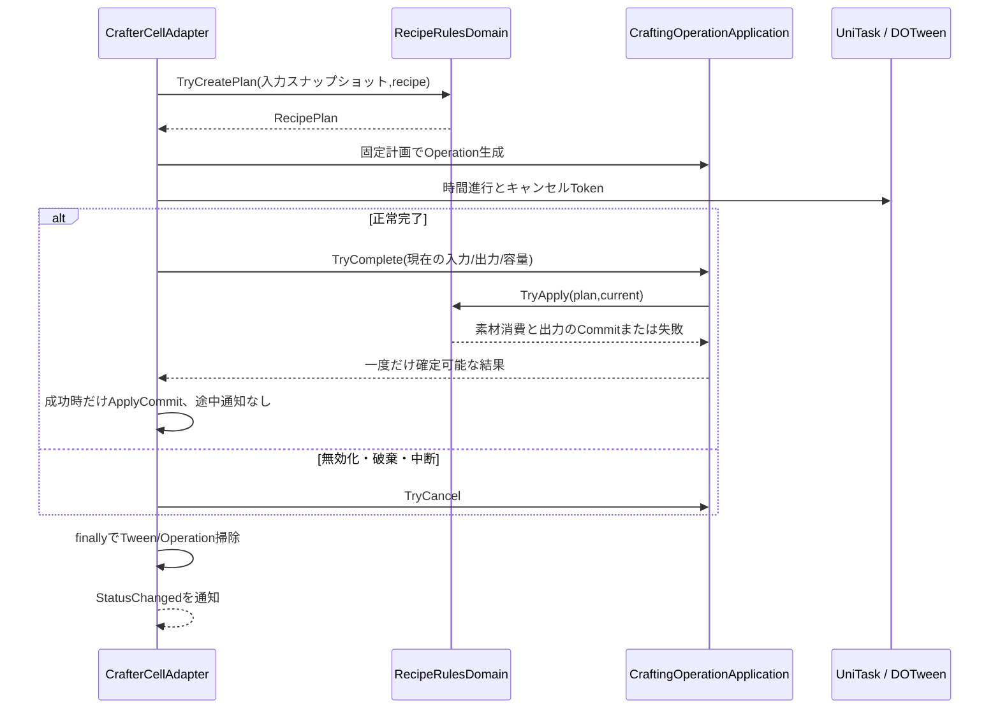
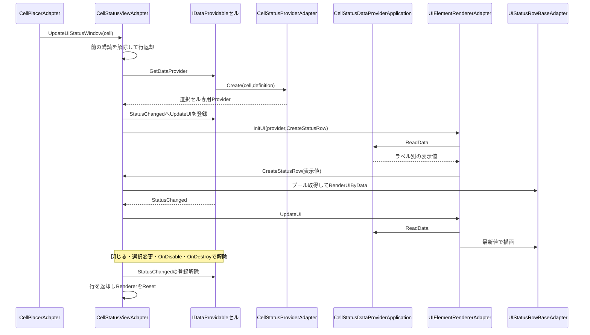

# 起動・配置・搬送・加工・選択のシーケンス

タグ: `現行設計` `シーケンス` `初期化` `配置` `搬送` `加工` `UI`

対象版・凡例は [現行設計索引](current-architecture.md)。実線は呼出、破線は値/通知。Unityが異なるコンポーネントへ行うStartの総順序は固定されていないため、起動図のparは独立経路であり、行順による実行順保証を意味しない。

## 起動と定義の読み取り

根拠: [CellDB](../../Assets/Scripts/Grid/Definitions/CellDatabaseDefinition.cs)、[Generator](../../Assets/Scripts/Grid/Adapter/GridFieldGeneratorAdapter.cs)、[Builder](../../Assets/Scripts/UI/Adapter/SelectButtonBuilderAdapter.cs)。起動時のグリッド登録は全セルのInitializeSystem呼出ではない。ゲーム開始前の生成はEditor操作の別経路。

## ボタン選択からドラッグ配置

根拠: [Cursor](../../Assets/Scripts/Input/Adapter/PlayerCursorBehaviourAdapter.cs)、[Placer](../../Assets/Scripts/Grid/Adapter/CellPlacerAdapter.cs)、[Connectable](../../Assets/Scripts/Cells/Adapter/ConnectableCellBaseAdapter.cs)。空セルへの配置またはEmptyによる削除だけを許す。UnityのDestroyは破棄予約だが、切断と配列差替えを先に処理する。

## 搬送の予約・演出・確定

根拠: [Coordinator](../../Assets/Scripts/Transfers/Application/ResourceTransferCoordinatorApplication.cs)、[Reservation](../../Assets/Scripts/Transfers/Application/ResourceReservationApplication.cs)。target取得とisCurrentTargetデリゲートで接続を再確認し、予約失敗は非同期待機する。Crossingは上流の予約時に下流も予約するため図の最初の予約を既に保持した経路を持つ。ExportConveyorの取り込みはTryExport→CreateIdFromResourceData→後方から自セルへの演出→基底の前方搬送という追加経路。所有セル終了時の最終ID処分は上図の待機復帰とは異なる。

## 加工の開始と一度きり確定

根拠: [Crafter](../../Assets/Scripts/Crafting/Adapter/CrafterCellAdapter.cs)、[CraftingOperation](../../Assets/Scripts/Crafting/Application/CraftingOperationApplication.cs)。無効化はCTSを取消し未完了の素材を消費しない。正常終了でも現在在庫や容量が不一致なら確定しない。

## 選択UIの読み取りと購読寿命

根拠: [View](../../Assets/Scripts/UI/Adapter/CellStatusViewAdapter.cs)、[Renderer](../../Assets/Scripts/UI/Adapter/UIElementRendererAdapter.cs)。同じ選択セルではProvider作成・行借用を繰り返さず更新する。Provider非対応セルは閉じる。ResourceCellの購読アクセサはno-opで初回読み取りだけで固定値を表示する。
