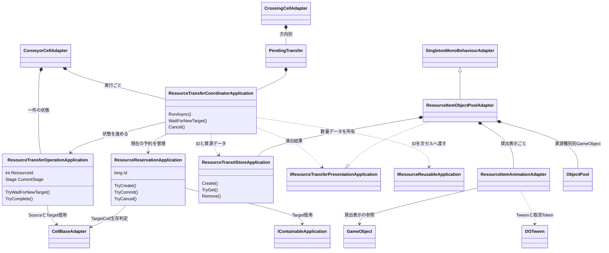
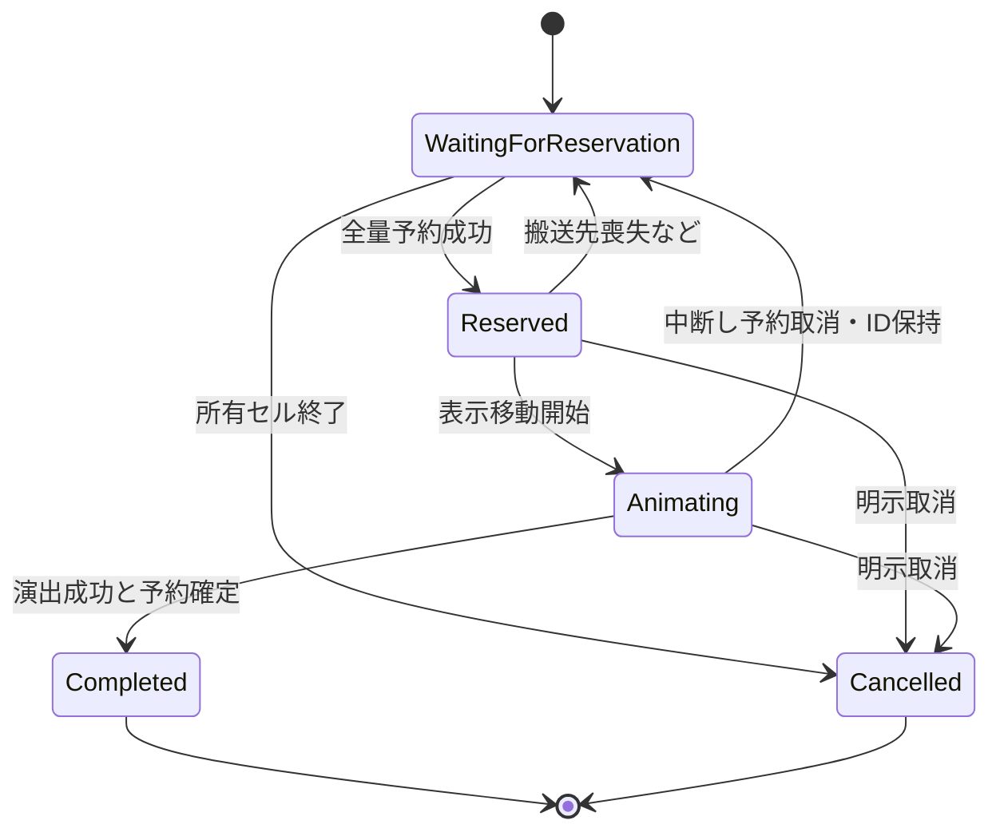
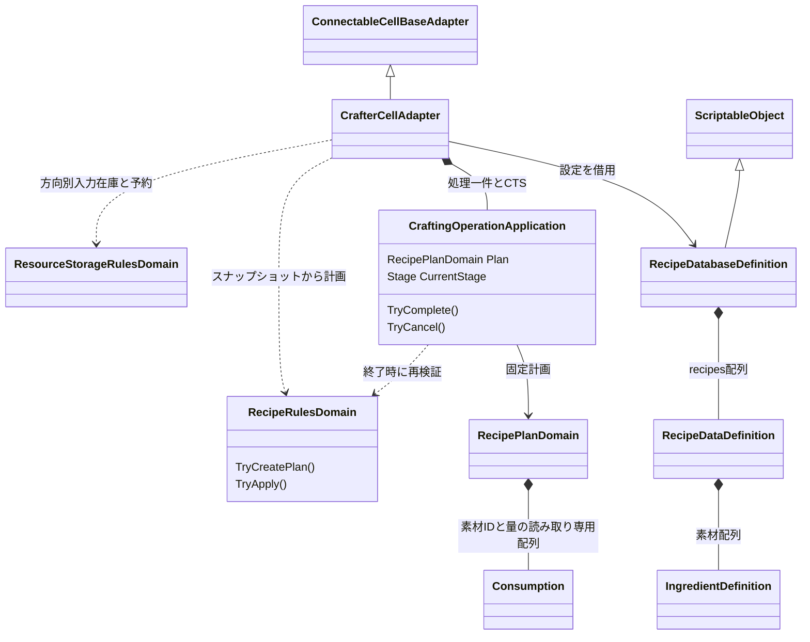

# 搬送と加工のクラス・状態関係

タグ: `現行設計` `搬送` `予約` `加工` `所有` `クラス図`

対象版・矢印は [現行設計索引](current-architecture.md)。所有はC#状態の生成・終了責任、参照は借用で表す。

## 搬送一件と演出の分離

[Coordinator](../../Assets/Scripts/Transfers/Application/ResourceTransferCoordinatorApplication.cs)、[Operation](../../Assets/Scripts/Transfers/Application/ResourceTransferOperationApplication.cs)、[Reservation](../../Assets/Scripts/Transfers/Application/ResourceReservationApplication.cs)、[Pool](../../Assets/Scripts/Transfers/Adapter/ResourceItemObjectPoolAdapter.cs) が根拠。Conveyorは一件、CrossingのPendingTransferは方向別にCoordinatorを保持し、予約を受けた後に資源IDを受け取る。上図のOperation/Storeメソッドは詳細な引数を省略している。貸出表示が戻っても資源データは自動消滅せず、通常終端ではデータ削除と表示返却を明示する。Reusable搬送先は同じIDを継承する。

これはOperationの代表経路。[搬送状態契約](../spec/resource-transfer-state.md) が遷移条件の正本。Reservationは別のPending/Committed/Cancelled状態で一度だけ確定または取消する。終了時のCTS取消、予約取消、資源ID破棄は所有セルとCoordinatorの責務を分担する。Crossingの接続喪失は同じOperationを待機へ戻す。Conveyorでは試行のCTSを取消しOperationをCancelledにして、同じ資源IDのまま次の試行に新しいOperationを作る。所有セル破棄は資源処分となるため混同しない。

## 加工計画と在庫確定

[Crafter](../../Assets/Scripts/Crafting/Adapter/CrafterCellAdapter.cs)、[RecipeRules](../../Assets/Scripts/Crafting/Domain/RecipeRulesDomain.cs)、[Operation](../../Assets/Scripts/Crafting/Application/CraftingOperationApplication.cs)、[RecipeDB](../../Assets/Scripts/Crafting/Definitions/RecipeDatabaseDefinition.cs) が根拠。RecipeDataDefinitionはSO内のシリアライズ可能な普通のクラスで、レシピ個別SOではない。入力・出力在庫はCrafter、加工計画はRecipePlan、加工StageはOperationが保持する。開始時に最初に成立したレシピから固定計画を作り、完了時の在庫と容量を再検証する。ApplyCommitは途中にawaitや通知を挟まず素材消費と出力増加を適用する。finallyは取消・Tween掃除・表示通知を担い、素材を無条件に消費しない。無効化・破棄は未完了計画を取消し、再有効化は初期化済みなら処理を再開する。
