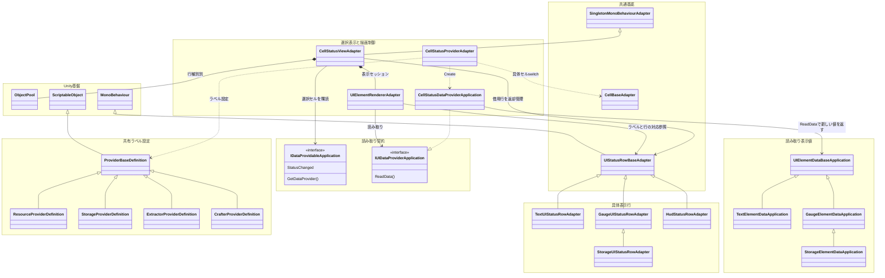
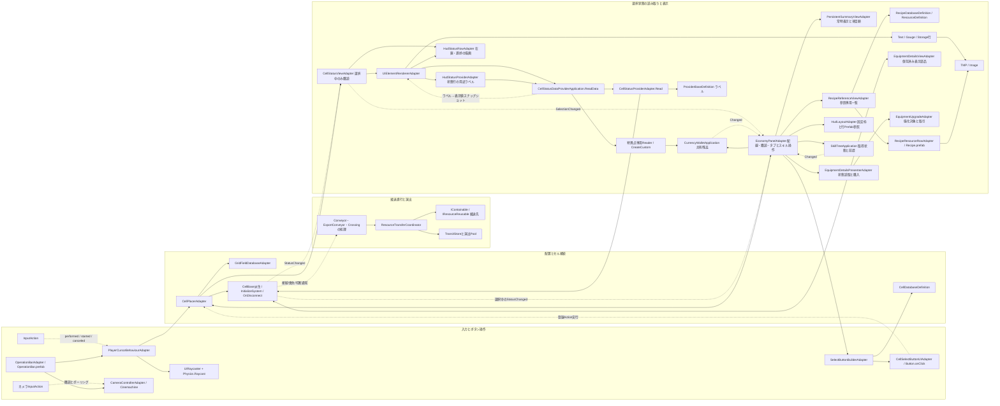

# 状態UIとスクリプト相関

タグ: `現行設計` `UI` `イベント購読` `データ授受` `依存`

対象版・凡例は [現行設計索引](current-architecture.md)。スクリプト全件は [対応表](script-catalog.md)。同名ノードは対応するC#型で、機能をまとめたノードはラベルで区別する。

## 表示セッションと値のクラス関係

<!-- diagram-id: architecture-ui-events-1 -->

[UI契約](../spec/cell-status-ui.md)、[Provider変換](../../Assets/Scripts/UI/Adapter/CellStatusProviderAdapter.cs)、[View](../../Assets/Scripts/UI/Adapter/CellStatusViewAdapter.cs)、[Renderer](../../Assets/Scripts/UI/Adapter/UIElementRendererAdapter.cs) が根拠。既存4種類はCreateの型分岐、追加セルはCreateCustomへ渡す専用Adapterの読み取り関数で同じProviderへ接続する。後者は中央のReadへ型を登録しない。ProviderDefinitionはラベル設定で、選択セルの参照を保存しない。選択ごとにProviderが作られ、読むたび新しい表示値を返す。表示値はpublicフィールドを持つスナップショットで、不変オブジェクトとは断定しない。Storage行はResourceDefinitionからアイコンを読む。Viewの選択解除・閉じる・OnDisable・OnDestroy時に購読解除と行返却、LateUpdateで破棄セルの選択解除を行う。

## 入力・イベント・データの相関

<!-- diagram-id: architecture-ui-events-2 -->

点線は左から右へのイベント／値の授受、実線は利用側→依存先。InputActionはOnEnableで有効化・購読、OnDisableで解除。左ボタン開始→PointerBegin、保持中Update→PointerDrag、終了→UI外ならPointerEnd、UI上ならプレビュー取消、右操作→TransferDataToUI。回転操作はPlacerの向きを変える。選択ボタンはBuilderがDBから生成し通常ボタンにSetSelectedCellTypeを渡す。SubMenuUIBuilderは同じセル定義から採取設備の候補を生成し、選択をPlacerへ渡す。接続イベントは隣接参照を更新してから通知し、UIのStatusChangedとは別系統である。

## 配置・成長の統合UIと特異点表示（ECO-05・ECO-07）

GeneratorがEconomyPanelAdapterを構成し、共有残高・スキル・設備強化を渡す。UIS-05では左側の直接タブを配置・レシピ・スキルへ切り替え、常時表示をPersistentSummaryViewAdapter、レシピ参照をRecipeReferenceViewAdapter、右側の強化表示をEquipmentDetailsViewAdapter、状態読取と購入をEquipmentDetailsPresenterAdapterへ委譲する。購入可否は既存のCanPurchaseを表示し、購入命令を既存Applicationへ渡す。設備の能力比較はセルのレベル指定読み取りを使い、実レベルと在庫を保つ。常時表示は残高と追加項目を横並び・折返しで全て表示し、左右パネルが枠の高さへ追従する。

CellStatusViewAdapterは選択・Provider・行プールを管理する。統合HUDではHudStatusProviderAdapterが見出しとの重複を省き、在庫・進捗の用途ラベルを付け、HudStatusRowAdapterが共通書体で描画する。行と強化欄は同じ右側スクロール内に置く。UIS-06ではFactoryHudとOperationBarのPrefabへ固定枠を保存し、変動する一覧だけを行Prefabから生成する。EconomyPanelAdapterの破棄時は購読と購入リスナーを解除して保存済みHUDを非表示にする。配置の基準と参照はHudLayoutAdapterが保持する。

特異点は専用ReaderとSingularityProviderDefinitionをCreateCustomへ渡す。残高と換金待ちを取得し、残高通知をStatusChangedへつなぐ。経済UIは選択切替で前のセル、無効化・破棄で全購読を解除する。左ページの開閉では購読を保ち、残高と右側の状態を更新する。UIRaycasterはEventSystemの全Canvasを照合し、追加パネル上の操作をフィールドから遮る。表示項目・操作・検証入口は[経済UI仕様](../spec/currency-loop-ui.md)を参照する。
