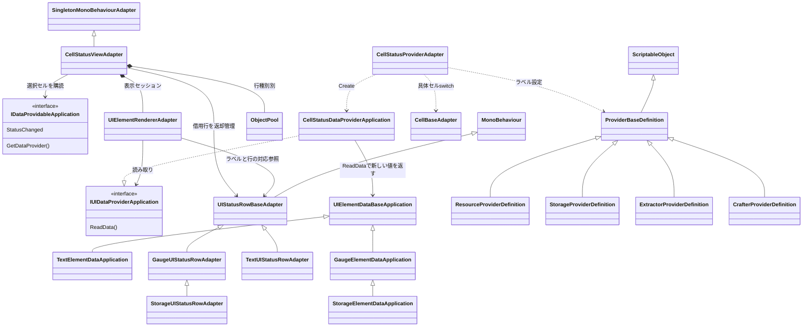
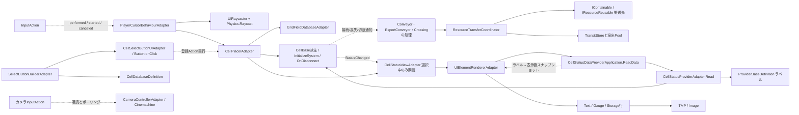

# 状態UIとスクリプト相関

タグ: `現行設計` `UI` `イベント購読` `データ授受` `依存`

対象版・凡例は [現行設計索引](current-architecture.md)。スクリプト全件は [対応表](script-catalog.md)。同名ノードは対応するC#型で、機能をまとめたノードはラベルで区別する。

## 表示セッションと値のクラス関係

<!-- diagram-id: architecture-ui-events-1 -->

[UI契約](../spec/cell-status-ui.md)、[Provider変換](../../Assets/Scripts/UI/Adapter/CellStatusProviderAdapter.cs)、[View](../../Assets/Scripts/UI/Adapter/CellStatusViewAdapter.cs)、[Renderer](../../Assets/Scripts/UI/Adapter/UIElementRendererAdapter.cs) が根拠。ProviderDefinitionはラベル設定で、選択セルの参照を保存しない。選択ごとにProviderが作られ、読むたび新しい表示値を返す。表示値はpublicフィールドを持つスナップショットで、不変オブジェクトとは断定しない。Storage行はResourceDefinitionからアイコンを読む。Viewの選択解除・閉じる・OnDisable・OnDestroy時に購読解除と行返却、LateUpdateで破棄セルの選択解除を行う。

## 入力・イベント・データの相関

<!-- diagram-id: architecture-ui-events-2 -->

点線は左から右へのイベント／値の授受、実線は利用側→依存先。InputActionはOnEnableで有効化・購読、OnDisableで解除。左ボタン開始→PointerBegin、保持中Update→PointerDrag、終了→PointerEnd、右操作→TransferDataToUI。回転操作はPlacerの向きを変える。選択ボタンはBuilderがDBから生成し通常ボタンにSetSelectedCellTypeを渡す。SubMenuUIBuilderは未完成の分岐を含み、完全なサブメニュー機構として図に展開しない。接続イベントは隣接参照を更新してから通知し、UIのStatusChangedとは別系統である。
