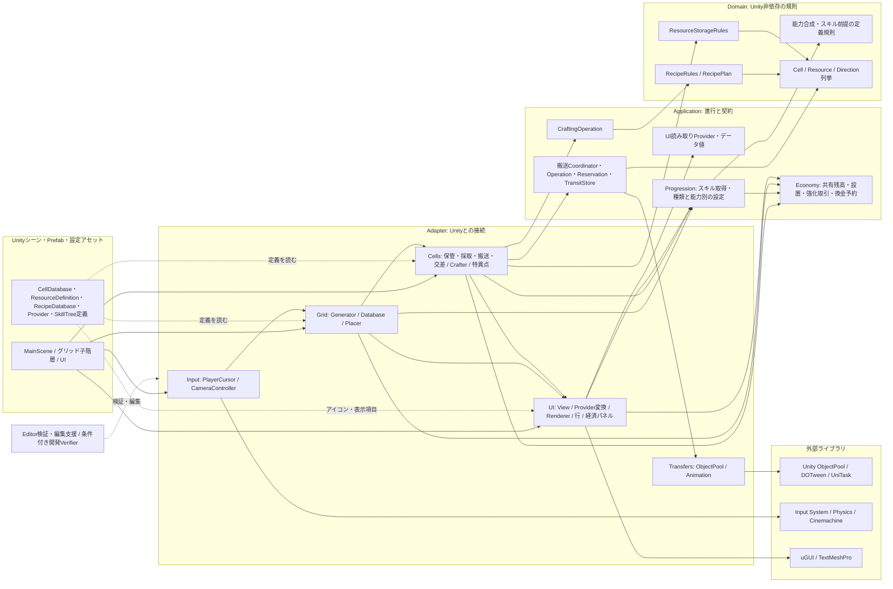
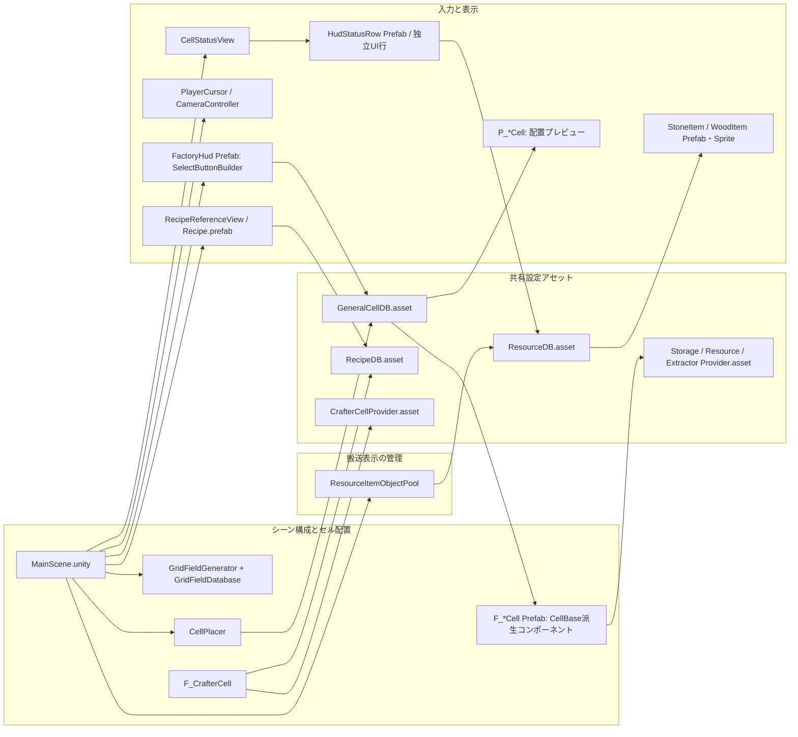

# FactoryGame 現行設計図式

タグ: `現行設計` `クラス図` `スクリプト相関` `設計パターン` `Unity` `再開情報`

確認日: 2026-10-14。対象コード: `901e72b4011dee5f912ec27cb255b2970d421c08` からのTRN-01差分。搬送先の識別・生存・操作を契約へ移し、現行仕様と検証は [搬送接点の契約](../spec/resource-transfer-state.md) を参照する。

この文書は現在動く仕組みの静的説明である。[設計方針](architecture-guidelines.md)の到達像と区別する。

今後のゲームループは[コンセプトと採用方針](game-concept.md)、実装順は[特異点への累計納品と出荷の分離計画](../tasks/black-hole-loop-plan.md)を参照する。現在の換金専用特異点からの拡張であり、納品・出荷セル・段階目標は実装前の仕様として扱う。

PRG-01の能力合成は[設備の有効能力](../spec/effective-stats.md)を参照する。グリッドが共有効果を所有し、登録時に各設備へ渡す。セルは種類・能力別の倍率と加算値、基礎設定から有効値を読み、稼働中の数量・予約・加工計画を保持する。

## 読み方と対象範囲

UIS-05は上部の常時表示、左の配置・レシピ・スキル、右のセル情報と設備強化へ表示を分ける。EconomyPanelAdapterが配線と購読を、各Viewが表示を所有し、購入判定は既存Applicationへ渡す。責務・依存と検証は[経済UI仕様](../spec/currency-loop-ui.md#uis-05の責務と検証)と[UI・イベント](architecture-ui-events.md)を参照する。

UIS-04の[下部操作帯](../spec/currency-loop-ui.md#画面下の操作帯uis-04)は、カーソルが生成する`OperationBarAdapter`からカーソルの配置方向とカメラの視点切替へ接続する。既存のUI入力遮断を使い、左右HUDは下部操作帯の余白を確保する。

原本は各Markdownの `mermaid` ブロック。概要から機能別へ読む。[セル・配置](architecture-cells-grid.md)、[搬送・加工](architecture-transfers-crafting.md)、[UI・イベント](architecture-ui-events.md)、[起動と操作シーケンス](architecture-sequences.md)、[全スクリプト対応表](script-catalog.md)で実ファイルに遡れる。既存閲覧用SVGと説明更新・検証手順は [図の検証記録](architecture-diagram-verification.md)を参照する。

自作C#の `Assets/Scripts/` を対象とする。Domainは数量・レシピ規則、Applicationは処理進行・読み取り契約、AdapterはUnity接続、Definitionsは設定、Editorは編集支援と検証入口。フォルダーは責務の整理であり、asmdefによる境界強制はない。C++/Pythonの製品モジュールはこの範囲にない。外部パッケージの内部型・生成コード・素材シェーダーは展開しない。

フロー図の実線 `A --> B` はAがBを呼ぶ／参照する依存、点線は設定供給や結果通知などラベルに示したデータの流れ。クラス図の `子 --|> 親` は継承、`実装 ..|> 契約` は実装、`所有者 *-- 内部状態` は生成と管理を担う所有、`A --> B` は借用参照、`A ..> B` は一時的な利用。Unity GameObjectの破棄権限とC#参照の所有は別で、隣接セルやSOは借用する。シーケンス図の実線は呼出、破線は返り値／通知。すべてのイベント矢印には発行元と購読先を明記する。

2026-10-12の配色・分類更新では、foundationは根底の規則・共通基底、middleは具体実装・実行状態・制御、surfaceは接続・能力契約、externalは自プロジェクト外の依存または検証支援を表す。自repoの型は、図の外から参照する型でもexternalには分類しない。クラス図のnamespaceは説明上の囲みで、C#の名前空間ではない。状態図の開始・終了記号には役割を付けず、状態遷移とシーケンスの既存の分岐・処理順は保持する。

## 通貨・初期特異点・設備設置（ECO-01/02/03）

2026-10-21にEconomyのDomain/Applicationと設定定義を追加した。[通貨の仕様・依存・検証](../spec/currency-wallet.md)を参照する。構成入口が価格カタログと共有残高を生成して渡す。ECO-02ではGeneratorが同じ残高と価格カタログを中央の特異点へ渡し、搬送成功時に換金する。[特異点・初期経路・保護・検証](../spec/currency-singularity.md)を参照する。

ECO-03では同じ残高をCellPlacerへ渡し、[設備設置の支出取引](../spec/currency-placement.md)へ接続した。新セルの登録・初期化成功時だけ課金し、失敗時は元のグリッド参照と予約額を復元する。範囲はドラッグ順に確定し、不足・失敗で停止する。設置見積りと確定個数・支出額を表示する。

## 共有スキルと設備能力（PRG-01/02）

能力合成とセル登録時の共有状態接続は [有効能力仕様](../spec/effective-stats.md)、ツリー定義・取得前提・購入取引は [共有スキルツリー仕様](../spec/skill-tree.md) を参照する。GeneratorはMainSceneのSkillTree定義からカタログを作り、共有残高とグリッドの共有効果を `SkillTreeApplication` へ渡す。取得状態と効果を更新して支出を確定し、能力とツリーの変更を通知する。PRG-03では既存3系統を5種類・8能力系統のI/IIへ統合し、同種の既設・新設・再有効化セルが共有能力設定を読む。

## 全体構成

PRG-03の[種類別強化](../spec/currency-equipment-upgrade.md)では、通常の購入入口をSkillTreeApplicationへ集約する。Generatorは旧個別購入Adapterを生成せず、セル選択欄は読み取り専用とする。旧個別購入と加算率の設定・処理・専用検証は撤去し、種類別強化だけを検証する。取得後も在庫・接続・予約・稼働中の数量を保持する。

<!-- diagram-id: current-architecture-1 -->

搬送Applicationは接点の契約を使い、セルの識別・Unity破棄判定はAdapter側が提供する。搬送契約はUnity座標型、演出契約はUniTaskも使う。UI/ApplicationとCrafting Domain/ApplicationはUnity非依存。Unity 6000.3.8f1、Input System 1.18.0、Cinemachine 3.1.4、uGUI 2.0.0、URP 17.3.0は [ProjectVersion](../../ProjectSettings/ProjectVersion.txt) と [manifest](../../Packages/manifest.json)で確認。UniTaskはGit依存、DOTweenはAssets内の既存プラグイン。Test Frameworkは検証境界で、ゲーム実行の入口ではない。

## 実際のUnity配線

<!-- diagram-id: current-architecture-2 -->

線はシリアライズ参照／コンポーネント配置の要約。シーンのローカルfileIDとPrefab overrideを含めて確認した。一般セル10定義は [GeneralCellDB](../../Assets/Scripts/ScriptableObject/GeneralCellDB.asset) の `fieldCellPrefab` / `placeholderCellPrefab` と [Field Prefab群](../../Assets/Prefabs/Field/General/) を参照する。加工Prefabは [F_CrafterCell](../../Assets/Prefabs/Field/General/F_CrafterCell.prefab) の `recipeDatabase` / `crafterProvider`、保管は [F_StorageCell](../../Assets/Prefabs/Field/General/F_StorageCell.prefab) の `dataProvider`、採取は [F_ExtractorStoneCell](../../Assets/Prefabs/Field/General/F_ExtractorStoneCell.prefab) の `resourceDatabase` / `extractorProvider` が根拠。[MainScene](../../Assets/Scenes/MainScene.unity) は上記管理コンポーネントを含む。 [FactoryHud](../../Assets/Prefabs/UI/FactoryHud.prefab) の配置BuilderはGeneralCellDBとSelectButtonを参照し、Placerはシーン参照で接続する。既存グリッドの子階層を起動時に登録し、実行中の配置ではPrefabを複製する。SOは設定を所有し、セル在庫・搬送中資源は所有しない。

## 設計パターン対応表

| 方式 / 成立範囲 | 実クラスと根拠 | 適用目的 / 留意点 |
| --- | --- | --- |
| 軽量レイヤード（部分的Ports and Adapters） | [Coordinator](../../Assets/Scripts/Transfers/Application/ResourceTransferCoordinatorApplication.cs) のRunAsync、[演出契約](../../Assets/Scripts/Transfers/Application/IResourceTransferPresentationApplication.cs)、[数量規則](../../Assets/Scripts/Resources/Domain/ResourceStorageRulesDomain.cs) | 演出と数量確定を分離。搬送先は操作・識別・生存の契約で接続する。Unity座標型・UniTaskへの依存は残る |
| Singleton（Unityシーン検索方式） | [SingletonMonoBehaviourAdapter](../../Assets/Scripts/Shared/Adapter/SingletonMonoBehaviourAdapter.cs) のInstance/Awake、GridDB・Pool・StatusView | 共通管理オブジェクト参照。シーン検索と重複破棄で、永続化やDIコンテナではない |
| Observer（C#イベント） | [IDataProvidable](../../Assets/Scripts/UI/Application/IDataProvidableApplication.cs) のStatusChanged、[CellStatusView](../../Assets/Scripts/UI/Adapter/CellStatusViewAdapter.cs) の選択時購読・解除、[ConnectableCellBase](../../Assets/Scripts/Cells/Adapter/ConnectableCellBaseAdapter.cs) の接続通知 | 選択中のUIと隣接接続の反応。ResourceCellの変更イベントはno-op。汎用イベントバスではない |
| Object Pool | [ResourceItemObjectPool](../../Assets/Scripts/Transfers/Adapter/ResourceItemObjectPoolAdapter.cs) の種別別ObjectPool、[CellStatusView](../../Assets/Scripts/UI/Adapter/CellStatusViewAdapter.cs) の行別ObjectPool | GameObject再利用。資源IDのデータ寿命はTransitStoreが別管理し、表示返却と数量削除を区別する |
| Simple Factory相当（部分適用） | [CellStatusProviderAdapter](../../Assets/Scripts/UI/Adapter/CellStatusProviderAdapter.cs) のCreate、[CellDatabase](../../Assets/Scripts/Grid/Definitions/CellDatabaseDefinition.cs) と [Placer](../../Assets/Scripts/Grid/Adapter/CellPlacerAdapter.cs) の型選択・Instantiate | 選択セルのProvider生成／定義からPrefab選択。Creator継承を使うGoF Factory Methodではない。既存4種類の表示変換は具体セルswitchに依存。追加セルはCreateCustomへ専用の読み取り関数を渡せる |
| Adapter / 表示分離（独自） | CellStatusProviderAdapter、[UIElementRenderer](../../Assets/Scripts/UI/Adapter/UIElementRendererAdapter.cs)、[行基底](../../Assets/Scripts/UI/Adapter/UIStatusRowBaseAdapter.cs) | セルを共通読み取り契約・表示データへ変換。View/Provider/Renderer分業はあるが完全なMVC/MVPと断定しない |
| 明示状態機械（独自） | [TransferOperation](../../Assets/Scripts/Transfers/Application/ResourceTransferOperationApplication.cs)、[CraftingOperation](../../Assets/Scripts/Crafting/Application/CraftingOperationApplication.cs) | Stageとガード付き遷移で二重確定・取消を防ぐ。状態ごとの多態クラスを持つGoF Stateではない |
| 予約トークン＋確定/取消（独自） | [ResourceReservation](../../Assets/Scripts/Transfers/Application/ResourceReservationApplication.cs) のTryCreate/TryCommit/TryCancel | 全量予約と一度きり確定。プロセス内ゲーム操作であり永続化トランザクションではない |
| 不変加工計画＋純粋規則 | [RecipePlan](../../Assets/Scripts/Crafting/Domain/RecipePlanDomain.cs)、[RecipeRules](../../Assets/Scripts/Crafting/Domain/RecipeRulesDomain.cs) のTryCreatePlan/TryApply | 開始時に素材計画を固定し、終了時に現在在庫へ再適用。SOと実行状態を切り離す |
| ScriptableObject設定 / データ駆動（Unity方式） | CellDatabaseDefinition、ResourceDefinition、RecipeDatabaseDefinition、ProviderBaseDefinition | Prefab・アイコン・レシピ・表示ラベルを編集可能な定義へ集約。SO自体をゲーム状態やRepositoryパターンとは扱わない |
| 継承＋仮想フック（Template Method的な部分） | CellBase / ConnectableCellBase / Conveyor / ExportConveyor のInitializeSystem | 共通接続処理をbase呼出で再利用。派生型が呼出順も制御し、固定されたテンプレートではない |

## 基礎ゲームループの統合（ECO-06）

MainSceneの共有残高と初回経路、実際の換金収益による全5種類・8能力系統のI/II取得・新設設備への再投資は[統合仕様](../spec/currency-game-loop.md)を参照する。[EconomyLoopVerifierEditor](../../Assets/Scripts/Economy/Editor/EconomyLoopVerifierEditor.cs)がPointer操作入口と経済パネルを通して能力と収支を確認し、既存の搬送・数量・抽出・加工・UI検証とWindowsビルドへ接続する。

## 図と説明の正本

2026-10-11に全14図・179ノードの概要・説明を [architecture-descriptions.json](architecture-descriptions.json) へ追加した。各Mermaidの固定diagram-idと図内ノードIDで対応する。説明は短い要約、詳細な契約や制約は本図式・コード・仕様文書を根拠とする。pilotの17件も保持している。説明を含む更新は [共通CLI契約](../../../../.codex/atlas/docs/opsis/opsis-update-tool.md) に従い、[更新手順と検証記録](architecture-diagram-verification.md)のdoctor→sync→inventory→apply→validateを使う。SVGは既存の閲覧用生成物で、説明の正本ではない。

## 更新・再開時

コードや配線変更時は本索引から該当機能図と対応表を更新する。採用済み作業の状態は [タスクリスト](../tasks/task-list.md)、作成根拠・提案の採用判断・更新手順は [引継ぎ手順](../tasks/design-review.md) を参照する。将来の改修案は根拠文書へ記録し、ユーザーの採用判断を受けて原本へ反映する。R1は完了版を説明し再実装していない。R2の採取寿命は2026-10-13の実装差分を反映し、検証結果は抽出セルの契約へ記録する。R3の専用取得入口と検証はUI契約へ記録する。TRN-01の接点契約と検証は搬送状態の契約へ記録する。asmdef導入は別の判断事項として扱う。検証は構文・参照・静的整合性に限定し、ゲーム体験や配置動作の新たな実行証拠を意味しない。

## 配置・経済・成長の操作表示（ECO-05・ECO-07）

[経済UI仕様](../spec/currency-loop-ui.md)に従い、Generatorが共有残高・スキル・強化処理をEconomyPanelAdapterへ渡す。パネルは残高と予約、換金通知、設置見積りと結果、選択設備の有効能力・強化費、スキルの前提・効果・可否を表示する。選択変更はViewのSelectionChanged、特異点の専用ReaderはCreateCustomへ接続する。パネルと選択の寿命に合わせて購読を解除する。

UIS-05では既存のSelectButtonBuilderを左の配置ページへ移し、レシピ・スキルと直接タブで切り替える。残高は上部に常時表示し、設備強化は右側のセル情報へ統合する。採取設備のサブメニューは同じセル定義とPlacerを使う。UI上で離した配置ドラッグは取消し、選択・表示切替では支払を行わない。

UIS-06ではMainSceneのHUDと操作帯を保存済みPrefabへ移し、固定枠・タブ・操作ボタンは起動時に生成しない。動的一覧は行Prefabを複製し、セル状態の読み取り専用表示はEquipmentDetailsPresenterAdapter、共用詳細枠はEquipmentDetailsViewAdapterが担当する。種類別強化はスキルノードから購入する。旧Canvas・UITab資産と移設・復元経路の整理、Editor編集範囲と検証は[HUDのPrefab仕様](../spec/currency-loop-ui.md#hudのprefabと編集範囲uis-06)を参照する。

加工品の板材・石レンガ・建築部材は、既存ResourceDB・RecipeDB・CurrencyEconomyの定義を追加して扱う。加工・搬送・保管・換金の実行経路は[加工仕様](../spec/crafting.md#追加した加工品とレシピ)を参照する。

採用済みの拡張計画は[マルチブロックセル対応計画](../tasks/multiblock-cell-plan.md)を参照する。5×5特異点の外周20入力、1×1基本加工の1入力、3×2上位加工の後辺2入力・前辺中央1出力を採用した。占有・回転、本体単位の登録と配置・撤去を実装済み。既存1×1設備のポート接続と予約を移行済み。5×5特異点と20入力、初期資源の上書きと外周基準の経路を実装済み。基本加工1×1・1入力、上位加工3×2・2入力と、それぞれの容量スキルを実装済み。配置・搬送・加工・スキル・PC2寸法のHUDとWindowsビルドを検証済み。セル・グリッド・搬送・加工・起動・配置の関連図も更新した。

一人称散策はCameraControllerAdapterが既存Cinemachineの追従・投影とカーソルを切り替え、FirstPersonWalkAdapterがグリッド占有に基づく移動と見回しを行う。実際のBody制御を停止して描画カメラの目線を保持し、0.5秒の往復補間中は配置を止める。FirstPersonChangedで入力と既存HUDを切り替え、戻る補間の完了後に通常UIを復元する。[操作と表示](../spec/currency-loop-ui.md#一人称の散策モード)を参照する。

HUDの押下・表示・状態変化の演出はHudMotionAdapterが既存DOTweenで行う。各Presenterが実際の残高変化や新規適用だけを通知し、購入判定・購読・表示切替は既存の担当に保つ。[UIアニメーション仕様](../spec/currency-loop-ui.md#操作と状態変化のアニメーション)を参照する。

PCのフィールド描画はUnity標準のフラスタムカリングを使う。GPU Resident DrawerとGPUオクルージョンは比較の結果、現行モデルでの処理時間増加と明るさの差を理由に既定無効とした。Editorだけで再比較できる入口を保持する。[採用設定と比較方法](../spec/field-rendering.md)を参照する。
