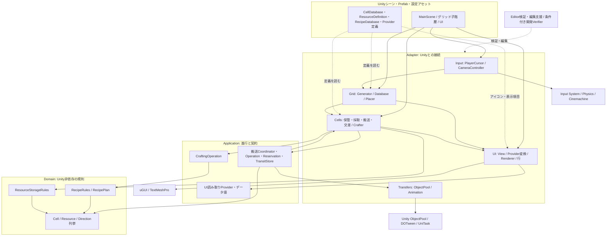
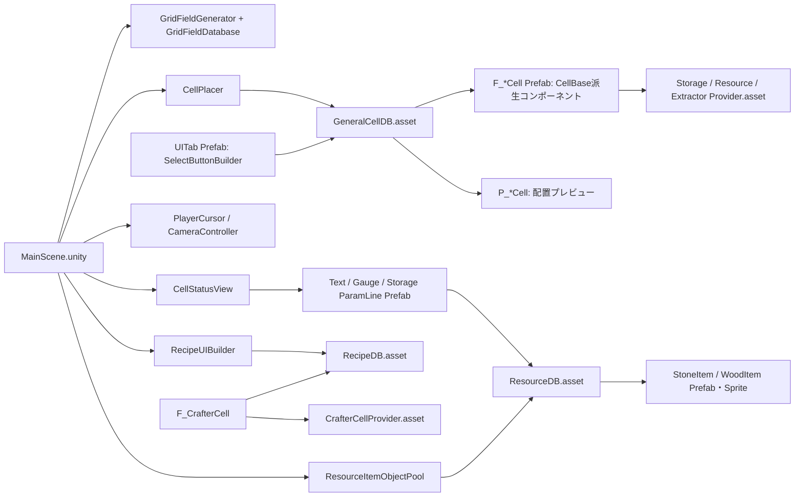

# FactoryGame 現行設計図式

タグ: `現行設計` `クラス図` `スクリプト相関` `設計パターン` `Unity` `再開情報`

確認日: 2026-10-11。対象コードHEAD: `f8e4daebe53a3b8239dcb2c1de1b9f315386e31b`（R1 セル定義の実行時初期化完了版）。本図式を追加する文書コミット後も、コード対象版はこのHEADである。

この文書は現在動く仕組みの静的説明である。[設計方針](architecture-guidelines.md)の到達像と区別する。未コミットの `ServiceLocatorAdapter.cs` は一覧に未採用候補として記載したが、現行ゲームの依存図には加えていない（呼出箇所なし）。`SampleSceneProfile.asset` の描画設定差分は存在を確認し、描画品質の評価を行わず境界の注記だけに反映した。IDEの4 XMLとServiceLocatorのmetaを含む着手前7ファイルは変更・コミット対象外。

## 読み方と対象範囲

原本は各Markdownの `mermaid` ブロック。概要から機能別へ読む。[セル・配置](architecture-cells-grid.md)、[搬送・加工](architecture-transfers-crafting.md)、[UI・イベント](architecture-ui-events.md)、[起動と操作シーケンス](architecture-sequences.md)、[全スクリプト対応表](script-catalog.md)で実ファイルに遡れる。閲覧用SVGと生成・検証方法は [図の検証記録](architecture-diagram-verification.md)を参照する。

自作C#の `Assets/Scripts/` を対象とする。Domainは数量・レシピ規則、Applicationは処理進行・読み取り契約、AdapterはUnity接続、Definitionsは設定、Editorは編集支援と検証入口。フォルダーは責務の整理であり、asmdefによる境界強制はない。C++/Pythonの製品モジュールはこの範囲にない。外部パッケージの内部型・生成コード・素材シェーダーは展開しない。

フロー図の実線 `A --> B` はAがBを呼ぶ／参照する依存、点線は設定供給や結果通知などラベルに示したデータの流れ。クラス図の `子 --|> 親` は継承、`実装 ..|> 契約` は実装、`所有者 *-- 内部状態` は生成と管理を担う所有、`A --> B` は借用参照、`A ..> B` は一時的な利用。Unity GameObjectの破棄権限とC#参照の所有は別で、隣接セルやSOは借用する。シーケンス図の実線は呼出、破線は返り値／通知。すべてのイベント矢印には発行元と購読先を明記する。

## 全体構成

この図の `Transfer --> Cells` は現行の具体型依存であり、理想の一方向レイヤー図から意図的に残している。搬送契約はUnity座標型、演出契約はUniTaskも使う。UI/ApplicationとCrafting Domain/ApplicationはUnity非依存。Unity 6000.3.8f1、Input System 1.18.0、Cinemachine 3.1.4、uGUI 2.0.0、URP 17.3.0は [ProjectVersion](../../ProjectSettings/ProjectVersion.txt) と [manifest](../../Packages/manifest.json)で確認。UniTaskはGit依存、DOTweenはAssets内の既存プラグイン。Test Frameworkは検証境界で、ゲーム実行の入口ではない。

## 実際のUnity配線

線はシリアライズ参照／コンポーネント配置の要約。シーンのローカルfileIDとPrefab overrideを含めて確認した。一般セル10定義は [GeneralCellDB](../../Assets/Scripts/ScriptableObject/GeneralCellDB.asset) の `fieldCellPrefab` / `placeholderCellPrefab` と [Field Prefab群](../../Assets/Prefabs/Field/General/) を参照する。加工Prefabは [F_CrafterCell](../../Assets/Prefabs/Field/General/F_CrafterCell.prefab) の `recipeDatabase` / `crafterProvider`、保管は [F_StorageCell](../../Assets/Prefabs/Field/General/F_StorageCell.prefab) の `dataProvider`、採取は [F_ExtractorStoneCell](../../Assets/Prefabs/Field/General/F_ExtractorStoneCell.prefab) の `resourceDatabase` / `extractorProvider` が根拠。[MainScene](../../Assets/Scenes/MainScene.unity) は上記管理コンポーネントを含む。 [UITab](../../Assets/Prefabs/UI/UITab.prefab) のセルDBはシーンoverrideでGeneralCellDBを指定する。既存グリッドの子階層を起動時に登録し、実行中の配置ではPrefabを複製する。SOは設定を所有し、セル在庫・搬送中資源は所有しない。

## 設計パターン対応表

| 方式 / 成立範囲 | 実クラスと根拠 | 適用目的 / 留意点 |
| --- | --- | --- |
| 軽量レイヤード（部分的Ports and Adapters） | [Coordinator](../../Assets/Scripts/Transfers/Application/ResourceTransferCoordinatorApplication.cs) のRunAsync、[演出契約](../../Assets/Scripts/Transfers/Application/IResourceTransferPresentationApplication.cs)、[数量規則](../../Assets/Scripts/Resources/Domain/ResourceStorageRulesDomain.cs) | 演出と数量確定を分離。搬送ApplicationはCellBase具体型・Unity・UniTaskに依存し、完全なHexagonal/Clean Architectureではない |
| Singleton（Unityシーン検索方式） | [SingletonMonoBehaviourAdapter](../../Assets/Scripts/Shared/Adapter/SingletonMonoBehaviourAdapter.cs) のInstance/Awake、GridDB・Pool・StatusView | 共通管理オブジェクト参照。シーン検索と重複破棄で、永続化やDIコンテナではない |
| Observer（C#イベント） | [IDataProvidable](../../Assets/Scripts/UI/Application/IDataProvidableApplication.cs) のStatusChanged、[CellStatusView](../../Assets/Scripts/UI/Adapter/CellStatusViewAdapter.cs) の選択時購読・解除、[ConnectableCellBase](../../Assets/Scripts/Cells/Adapter/ConnectableCellBaseAdapter.cs) の接続通知 | 選択中のUIと隣接接続の反応。ResourceCellの変更イベントはno-op。汎用イベントバスではない |
| Object Pool | [ResourceItemObjectPool](../../Assets/Scripts/Transfers/Adapter/ResourceItemObjectPoolAdapter.cs) の種別別ObjectPool、[CellStatusView](../../Assets/Scripts/UI/Adapter/CellStatusViewAdapter.cs) の行別ObjectPool | GameObject再利用。資源IDのデータ寿命はTransitStoreが別管理し、表示返却と数量削除を区別する |
| Simple Factory相当（部分適用） | [CellStatusProviderAdapter](../../Assets/Scripts/UI/Adapter/CellStatusProviderAdapter.cs) のCreate、[CellDatabase](../../Assets/Scripts/Grid/Definitions/CellDatabaseDefinition.cs) と [Placer](../../Assets/Scripts/Grid/Adapter/CellPlacerAdapter.cs) の型選択・Instantiate | 選択セルのProvider生成／定義からPrefab選択。Creator継承を使うGoF Factory Methodではない。表示変換は具体セルswitchに依存 |
| Adapter / 表示分離（独自） | CellStatusProviderAdapter、[UIElementRenderer](../../Assets/Scripts/UI/Adapter/UIElementRendererAdapter.cs)、[行基底](../../Assets/Scripts/UI/Adapter/UIStatusRowBaseAdapter.cs) | セルを共通読み取り契約・表示データへ変換。View/Provider/Renderer分業はあるが完全なMVC/MVPと断定しない |
| 明示状態機械（独自） | [TransferOperation](../../Assets/Scripts/Transfers/Application/ResourceTransferOperationApplication.cs)、[CraftingOperation](../../Assets/Scripts/Crafting/Application/CraftingOperationApplication.cs) | Stageとガード付き遷移で二重確定・取消を防ぐ。状態ごとの多態クラスを持つGoF Stateではない |
| 予約トークン＋確定/取消（独自） | [ResourceReservation](../../Assets/Scripts/Transfers/Application/ResourceReservationApplication.cs) のTryCreate/TryCommit/TryCancel | 全量予約と一度きり確定。プロセス内ゲーム操作であり永続化トランザクションではない |
| 不変加工計画＋純粋規則 | [RecipePlan](../../Assets/Scripts/Crafting/Domain/RecipePlanDomain.cs)、[RecipeRules](../../Assets/Scripts/Crafting/Domain/RecipeRulesDomain.cs) のTryCreatePlan/TryApply | 開始時に素材計画を固定し、終了時に現在在庫へ再適用。SOと実行状態を切り離す |
| ScriptableObject設定 / データ駆動（Unity方式） | CellDatabaseDefinition、ResourceDefinition、RecipeDatabaseDefinition、ProviderBaseDefinition | Prefab・アイコン・レシピ・表示ラベルを編集可能な定義へ集約。SO自体をゲーム状態やRepositoryパターンとは扱わない |
| 継承＋仮想フック（Template Method的な部分） | CellBase / ConnectableCellBase / Conveyor / ExportConveyor のInitializeSystem | 共通接続処理をbase呼出で再利用。派生型が呼出順も制御し、固定されたテンプレートではない |

## 更新・再開時

コードや配線変更時は本索引から該当機能図と対応表を更新する。将来の改修案は [拡張レビュー](../tasks/extension-readiness-review.md) 等のタスクへ記録し、現行図に混ぜない。R1は完了版を説明し再実装していない。R2採取寿命、R3表示変換、R4数量上限、asmdef導入は図式作成で完了扱いにしない。検証は構文・参照・静的整合性に限定し、ゲーム体験や配置動作の新たな実行証拠を意味しない。
