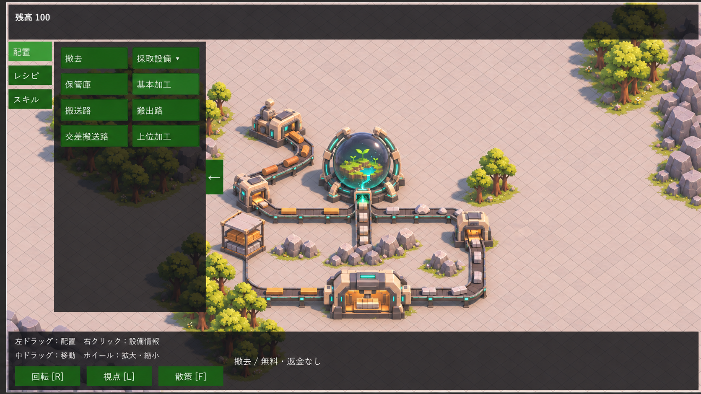

# ファクトリーのコンセプトとゲームループ拡張方針

タグ: `採用方針` `世界観` `ゲームループ` `特異点` `出荷` `累計納品` `アート方向`

更新日: 2026-11-11。状態: ユーザーとの方針整理。出荷セルへの換金分離、累計納品・段階目標と表示を実装済み。通しプレイによる数量調整は次工程である。現在動く仕様は[基礎ゲームループ](../spec/currency-game-loop.md)を参照する。

## ゲームの軸

工場で資源を採取・加工し、ブラックホール風の特異点へ送り込み続ける。出荷で得た通貨を設備と種類別スキルへ投資し、生産量と扱える加工品を増やす。特異点は工場の中心に置く、吸収し続ける存在とする。

小さな世界を育てる案は取り下げた。球体内部の大地・水・植物に代わり、ブラックホール風の外観と、物が吸い込まれ続ける表現を軸にする。

## 採用した進行方針

| 対象 | 採用内容 | 根拠 |
| --- | --- | --- |
| 特異点 | 成長・進行用の納品先。投入資源を吸収し続ける | 最後の世界観修正 |
| 出荷セル | 特異点とは別の換金先。出荷した資源の対価を共有残高へ加算する | 質問1B・3A |
| 納品と収益 | 同じ投入で納品進捗と通貨を同時に得ない。搬送先で用途を分ける | 質問1B |
| 目標 | 品目ごとの累計納品数で段階・最終目標の達成を判定する | 質問2B |
| 中断 | 搬送が止まっても確定済みの累計納品数を保持する | 質問2B |
| 目標達成後 | 特異点の吸収は続く。最終目標の達成と吸収停止を結び付けない | 吸収し続ける方針 |
| 再投資 | 既存の設備購入と種類別スキルを使う | 現在の操作と能力設定を活用 |

日常の操作は「出荷して稼ぐ → 設備・スキルを購入する → 生産を拡大する → 特異点へ納品する」の循環になる。換金用と納品用のラインを並行して運用し、どちらへ資源を送るかを工場の配置で決める。

## 最初に拡張する進行

現在の木材・石材・板材・石レンガ・建築部材と、基本加工1×1・上位加工3×2を使う。段階を進めるための新しい資源やレシピを先に増やさず、現在の生産経路へ目的を与える。

| 段階案 | 目標品の例 | プレイヤーが整えるもの |
| --- | --- | --- |
| 基礎投入 | 木材・石材 | 換金経路と納品経路、二種類の採取 |
| 加工投入 | 板材・石レンガ | 一材料加工、生産と出荷の配分 |
| 複合加工投入・最終目標 | 建築部材と加工品 | 二材料加工と、それを支える採取・搬送・保管 |

段階数・名称・必要個数は調整用の設計項目であり、この表の数値を確定値としてコードへ埋め込まない。一定時間の連続供給や供給速度の維持は今回の達成条件に含めない。納品数・段階状態は、現在の残高・スキルと同様に一プレイセッションが所有する。永続保存の導入は別の設計範囲とする。

## 外観の方向と画像の扱い

設備の共通素材は、アイボリーの外装・濃い金属・青緑の稼働光を候補とする。木材と岩石は自然な色を使い、採取・保管・加工の違いを輪郭と機構で見分けられるようにする。特異点は暗い中心、周囲のリングや光、搬送物の吸収を中心に表現する。具体的な形・色・演出強度はモデル制作時に比較する。

この画像は配色・設備造形・現行の画角を検討する参考画像であり、実装済み画面の証拠ではない。球体内部の小さな世界は取り下げた案の表現なので、今後の特異点モデルへ引き継がない。画像内の曲線搬送路や設備寸法も、現在のセル規格の正本にはしない。

設備は既存のModel PrefabとField／Placeholder Variantで制作する。基本加工1×1、上位加工3×2、特異点5×5の占有・接続口を保ち、俯瞰での識別と一人称での見え方を両方確認する。UIは残高・次の納品目標・進捗など操作判断に必要な情報に絞り、内部予約数は表示しない。

## 現在地と次の作業

出荷セルへの換金分離と、特異点の換金しない吸収を実装した。累計納品・段階設定・達成判定・HUD表示も実装した。目標数は仮値で、通しプレイとバランス調整を次工程とする。[ゲームループ拡張計画](../tasks/black-hole-loop-plan.md)で、実装箇所・順序・完了条件を整理する。現在動く設計と、採用した将来方針を区別して更新する。
