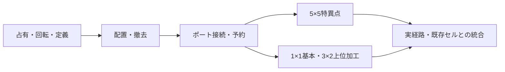

# マルチブロックセル対応計画

タグ: `計画案` `グリッド` `複数マス` `ポート` `加工` `換金`

更新日: 2026-11-10。状態: 採用済み計画。ユーザーが1A・2Aを選択。ゲーム本体は未実装。

## 到達点

| 対象 | 占有範囲 | 入力 | 出力 |
| --- | --- | --- | --- |
| 特異点 | 5×5 | 外周各辺5口、計20口 | 換金で消費 |
| 基本加工セル | 1×1 | 後辺1口 | 前辺1口 |
| 上位加工セル | 3×2。90度回転時は2×3 | 後辺の左右に2口 | 前辺中央1口 |

これらを既存の採取・搬送・保管・配置・撤去・種類別強化・状態表示と併用できる状態にする。長方形の寸法とポート数は定義から読み、処理を5×5や2入力へ固定しない。

## 調査した現状

- [GridFieldDatabaseAdapter](../../Assets/Scripts/Grid/Adapter/GridFieldDatabaseAdapter.cs)は各マスにCellBaseAdapterを一つ保存し、登録のたびにXIndex/ZIndexを更新する。初期化はSeparatorと子の順序へ依存する。
- [CellPlacerAdapter](../../Assets/Scripts/Grid/Adapter/CellPlacerAdapter.cs)は一つの空セルを一つの設備へ置き換える。占有範囲全体の配置・復元はまだ扱わない。
- [ConnectableCellBaseAdapter](../../Assets/Scripts/Cells/Adapter/ConnectableCellBaseAdapter.cs)は基準マスの隣接4マスと固定4スロットを使う。同じ側面の別の位置を識別できない。
- [搬入契約](../../Assets/Scripts/Transfers/Application/IContainableApplication.cs)と[予約](../../Assets/Scripts/Transfers/Application/ResourceReservationApplication.cs)は方向を接点の識別に使う。搬出演出の始点も設備のTransform位置を使う。
- [SingularityIntakeApplication](../../Assets/Scripts/Economy/Application/SingularityIntakeApplication.cs)は4入力枠を固定配列で保持する。
- [CrafterCellAdapter](../../Assets/Scripts/Crafting/Adapter/CrafterCellAdapter.cs)は方向ごとに入力を持つ。[加工計画](../../Assets/Scripts/Crafting/Domain/RecipePlanDomain.cs)は入力IDを既に扱うため、数量と確定・取消の規則を再利用できる。

## 設計案

### 設備の本体と占有マス

一つの設備に本体・在庫・加工状態・寿命を一つだけ持たせる。占有する各マスは同じ本体を参照する。例えば3×2セルは6台ではなく、6マスを占有する1台になる。

基準座標・長方形の寸法・0/90/180/270度の向きから占有マスを求める。基準座標とモデル中心を分け、回転後の占有範囲、当たり判定、選択枠、プレビューが一致するようにする。どの占有マスを選択しても同じ設備を取得する。件数の集計・初期化・強化通知では本体を一度だけ数える。

寸法とポートの編集元は既存のField Prefab内へまとめ、プレビューは同じ定義を参照する。独立した設定資産や、Field/Placeholder別の寸法設定は追加しない。定義を読み取るときに範囲・ID・外周位置を検証する。

占有計算はUnity非依存のDomain、配置の成否と登録・復元はApplication、Prefab・Collider・モデルとの対応はAdapterに置く。

### 外周のポート

ポートは設備内で固定のID、局所マス座標、外向きの方向、入出力の用途、対応する入力バッファを持つ。既存の保管庫などで必要な両用ポートも扱う。設備の回転から実際の座標と向きを求め、向かい合う接点同士を結ぶ。同じ設備の内部では接続しない。

予約は設備の寿命とポートIDを識別する。同じ辺の2口を方向だけでまとめない。加工の入力IDにもポートに対応する安定したIDを使う。ポートごとの入力容量と予約、共用する出力在庫の所有者を明確にする。搬送演出の始点・終点は接続したポートの位置に合わせる。

接続と切断は設備の外周付近だけを更新し、配置のたびに全グリッドを探索しない。既存1×1セルも同じ方式へ移し、旧4方向方式を恒久的な互換分岐として残さない。資源量の全量予約、確定・取消の一回性、資源IDと在庫の所有規則を引き継ぐ。

### 配置・撤去の単位

配置候補の全占有マスを先に調べ、範囲外・資源・既存設備との重なりを判定する。配置は1台分の価格を支出予約し、全マス登録と初期化が成功した後に一度だけ支払う。失敗時は占有・接続・旧セルと支出予約を一組で戻す。

大きい設備はまず1台ずつ配置する。1×1セルの既存連続ドラッグは維持する。大きい設備の自動敷き詰めは別の拡張とする。

撤去は占有マスのどこを指しても設備全体を一度だけ処理する。範囲撤去で同じ設備を重複処理しない。全ポートの接続と未完了予約を閉じ、占有マス全体を空へ戻す。返金は現在の方針を維持する。

## 実装の順序と各段階の完了条件

| 段階 | 主な変更 | その段階の完了条件 |
| --- | --- | --- |
| 1. 占有と定義 | 寸法・回転・占有マス計算、本体を返すグリッド登録、初期化の階層順依存を解消 | 1×1/3×2/5×5を4方向で登録でき、範囲外・重なりを拒否。同じ本体が重複初期化されない |
| 2. 配置と撤去 | 占有全体のプレビュー・価格・一括登録・失敗復元、当たり判定と選択枠 | 任意の占有マスから選択・撤去でき、初期化失敗や不足で一部分だけ残らない。1台1回の課金 |
| 3. ポート接続と予約 | 外周ポート探索、接続通知、搬入/搬出の接点識別、固定4枠を移行 | 同じ側の別口を区別し、回転・隣接設備撤去でも誤接続・予約漏れ・二重確定がない。既存搬送路/交差/保管が通る |
| 4. 5×5特異点 | 占有・見た目・Collider・入力枠、初期配置とカメラ中心 | 中央に本体1つ・25マスを登録し、採用した複数入力で同時に正しく換金。初回経路を構築できる |
| 5. 2種類の加工セル | 1×1の1入力、3×2の2入力、Prefab・配置一覧・価格・状態/スキル対象の接続 | 基本セルで板材/石レンガ、上位セルで建築部材を実加工。2入力の材料と予約が混ざらず、回転後も搬出可能 |
| 6. 統合と記録 | MainScene、既存Editor検証、設計図・仕様・生成済みScene参照、コミット | 下記の統合条件を満たし、保存・再読込した実ファイルと検証入力が一致する |

段階3までを共通基盤として先に通し、その後に特異点と加工セルへ適用する。各段階を独立して確認できる変更単位へ分ける。

## 開始配置とゲーム側への接続

現在の特異点中心は維持する。5×5は中心から各軸±2を占有するため、現在の木材と3セルの初回経路をそのまま置くと重なる。木材と経路を入口の外側へ移し、占有境界とポートから配置を計算する。フィールドの必要サイズも経路を含めて検証する。

カメラは大きい設備の基準マスではなく見た目の中心へ合わせる。右クリックは設備全体を選び、状態欄と種類別強化は占有マス数ではなく1台を対象にする。上位加工セルは別の設備種類として登録し、価格と能力値を既存定義で設定する。上下位のスキルを共用するか分けるかは、段階5で定義を確定する前に整理する。

1入力セルは材料条件が1件のレシピ、2入力セルは条件を満たす2材料レシピを扱う。材料を同じ入力へ混ぜて1入力制限を回避する仕組みは加えない。既存の加工計画・予約規則を使い、TestRecipeを含む既存レシピの実行先も入力数に合わせて確認する。

## 統合した完了条件

- 特異点5×5と加工セル3×2/2×3の全占有マスから選択でき、内部への別設備配置を拒否する。
- 3×2の角や辺1マスだけが重なる場合とグリッド端を越える場合も、配置前に判定できる。
- 特異点の同時搬入でポートごとの予約と換金が独立し、残高と資源数に重複や欠落がない。
- 上位加工セルの入力2口へ異なる資源を送り、建築部材を作って取り出せる。1×1セルは1口分だけ受け付ける。
- 搬送中・加工中の無効化、削除、隣接セルの撤去、再有効化で接続・予約・数量の契約を満たす。
- 既存の1×1搬送路・交差・保管・採取と併用でき、配置タブの入力遮断、残高、種類別強化が維持される。
- 初期Sceneの保存/再読込と再生し直しで、本体数・占有範囲・ポートが一致する。PrefabとSceneの変更対象を記録する。
- `CellConnectionVerifierEditor`、`EquipmentPlacementVerifierEditor`、`ResourceReservationVerifierEditor`、`ResourceTransferVerifierEditor`、`CraftingVerifierEditor`、`EconomyUIVerifierEditor`、`EconomyLoopVerifierEditor`など既存入口へ対象ケースを追加し、最終のプレイヤービルドを確認する。基盤変更のため、関係する入口はまとめて実行する。

今回の範囲は長方形の占有と定義可能なポート。非長方形・複数階・チャンク化・セーブ機能の新設やバランスの作り直しは別の計画とする。

## 採用したポート配置

2026-11-10、ユーザーが1A・2Aを採用した。

- 特異点は外周の各辺5口、計20口を入力にする。角のマスも、異なる2辺のポートを別IDで持つ。同じ辺からの複数搬入を独立して扱う。
- 上位加工セルは後辺の左右に入力2口、前辺中央に出力1口を持つ。幅3・奥行2の局所座標で、入力は(0,0)と(2,0)、出力は(1,1)とする。入力の外向き方向は後ろ、出力は前とする。
- 基本加工セルは後ろ1入力・前1出力とする。
- 回転時は占有範囲とポート位置・方向を同じ規則で変換し、ポートIDを保つ。配置はPrefabで編集し、処理に固定しない。

採用した実装順は、占有・回転 → 配置・撤去 → ポート接続・予約 → 特異点と加工セル → 統合検証。価格や上下位セルのスキル配分は、構造の仕様と分けて段階5で整理する。
